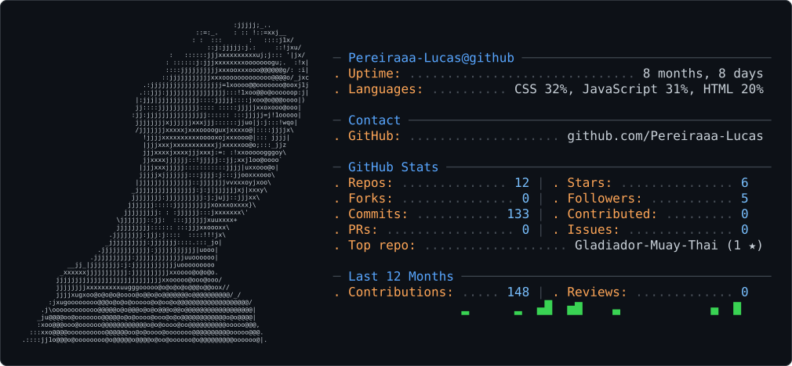

<picture>
  <source media="(prefers-color-scheme: dark)" srcset="dark_mode.svg" />
  <source media="(prefers-color-scheme: light)" srcset="light_mode.svg" />
  
</picture>

<h4 align="center">Desenvolvedor Front-End e Back-End em Formação | Análise e Desenvolvimento de Sistemas (ADS) @ Anhanguera</h4>

  Olá! Sou o <b>Lucas Pereira</b>, estudante de Análise e Desenvolvimento de Sistemas (previsão de conclusão: julho de 2028). Sou apaixonado por tecnologia e focado em transformar ideias em soluções digitais modernas, eficientes, responsivas e acessíveis.

---

### 🚀 Sobre Mim & Objetivos
* **Foco atual:** Em busca de oportunidades de **Estágio em Desenvolvimento Front-End** ou **Suporte Júnior**.
* **Filosofia de Código:** Acredito que um bom portfôlio vai muito além de um repositório de códigos: ele deve demonstrar clareza, resolução de problemas reais, boa documentação (storytelling nos READMEs) e consistência.

---

### 💻 Stack Tecnológica

  
  
  
  
  
  
  
  
  
  
  
  
  
  
  
  
  
  
  
  
  

---

### 🏆 Principais Certificações & Conquistas
* **Cloud & IA:** AWS Academy Graduate (Generative AI Foundations, Cloud Foundations), Google Cloud Skills Boost (*Implementação de Cloud Load Balancing, Fundamentos de Rede e Segurança, Criação de Sistemas Multiagente com ADK & MCP*).
* **Idiomas:** Inglês B1 Intermediário (Certificado EF SET).
* **Comunidade:** Contribuições ativas e conquistas de badges em eventos e desafios de código (como o *Pull Shark* no GitHub e participações no TDC 2026).

---

### 📊 Estatísticas do GitHub

  
  

---

### 📫 Vamos nos conectar?

  
  

